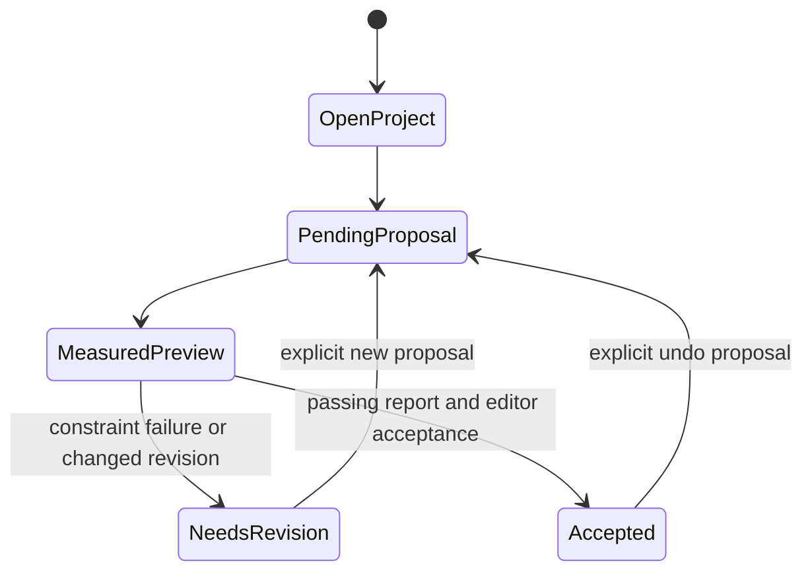

# Desktop workspace directions — consultation draft

These are three application workflow proposals. They do not select the card
frame's aesthetics, replace the portable JSON/Rust/stdin MCP architecture, or
implement a redesign. Local project selection, measured diagnostics, explicit
editor acceptance, revision identity and undo remain required in every direction.

## Inspected Mobbin references

The following preview images were inspected through the connected Mobbin tool
on 12 October 2026. Observations describe visible UI, not inferred hidden behavior.
Canonical screen links are retained; no screenshot or expiring image URL is
copied into the repository, and no reference assets are redistributed.

| Inspected screen | Visible evidence | Artificer inference |
| --- | --- | --- |
| [Figma canvas and layers](https://mobbin.com/screens/f38b50ab-950d-4721-9f6f-7373a43959c4) | Left page/layer tree, central boards, right styles/variables inspector | Separate project/card navigation, output preview and inherited template rules |
| [Figma selected object](https://mobbin.com/screens/b62f7a88-50de-4ef0-bd2f-a238d83dd36a) | Selected object on canvas; position and layout dimensions on the right | Show selected region geometry and constraint provenance beside the preview |
| [Airtable records and agent activity](https://mobbin.com/screens/b0d71be1-f088-4f2c-a31c-940d352ae81c) | Field columns and records beside an activity panel showing created records and an Undo action | A future linked data view could keep proposed changes visible beside affected cards; does not justify automatic commit |
| [Airtable expanded record](https://mobbin.com/screens/38bb29df-0691-457b-bf42-0b07c75fa17a) | Expanded record form above the grid, with a comments pane | Focus one card while retaining library context; batch/library scope remains future work |
| [Linear properties and activity](https://mobbin.com/screens/9f60b2e0-f2e9-4c19-afcc-f85910b88182) | Activity area beside status/assignment/project properties | Keep a proposal's state and provenance persistently visible |
| [Linear activity reply](https://mobbin.com/screens/2e6c00de-40a7-455d-875f-0d8cb27c8270) | Activity entry and reply field within the same detail view | Tie designer feedback to a specific proposal/revision, rather than a detached chat |

These web references inform desktop structure. Offline behavior, native menu
patterns and keyboard accessibility still need Artificer-specific validation.

## OpenDesign examples: documentation inspected, runtime not tested

“Open Design” is provisionally interpreted as
[nexu-io/open-design](https://github.com/nexu-io/open-design), linked by its
[official identity page](https://open-design.ai/official/). Confirm that identity
before installing or integrating it. This preparation installs nothing.

| Example | Documented evidence | Proposed adaptation, with limits |
| --- | --- | --- |
| [Dashboard starter](https://github.com/nexu-io/open-design/blob/main/design-templates/dashboard/SKILL.md) | Sidebar, top bar, independently scrolling content and semantic regions | Stable desktop workspace regions; card authoring does not need invented KPI charts |
| [Tweaks template](https://github.com/nexu-io/open-design/blob/main/design-templates/tweaks/SKILL.md) | Live parameter panel for an HTML stage, persisted through localStorage | Explore application density/theme in a disposable prototype; never replace project persistence or bypass locked card constraints |
| [Design-system package contract](https://github.com/nexu-io/open-design/blob/main/design-systems/README.md) | Current packages require manifest.json, DESIGN.md and tokens.css; component/asset evidence is optional; legacy DESIGN.md-only discovery remains supported | Separate Artificer's app design contract from card-template constraints; do not copy brand packages or assets |

The [OpenDesign README](https://github.com/nexu-io/open-design#demo) also describes
artifact previews and editable dashboards. Its roadmap still lists tweaks-panel
UX as unfinished, so a template's documented recipe is not proof of runtime
completion. No card fit, print preflight or native parity guarantee follows from
these examples. This research is not adopting upstream skill instructions.

## Three directions

| Direction | Proposed desktop arrangement | Strength / tradeoff | Smallest follow-up after selection |
| --- | --- | --- | --- |
| A — Card workbench | Project/card context left; large card center; rules/template inspector right; persistent diagnostics below; proposal review tab | Supports deliberate layout work and keeps constraints near the output; requires careful panel sizing on smaller screens | A single-card interaction sketch for inherited rules, preview evidence and acceptance; no library/schema expansion |
| B — Data and proof desk | Future record grid left/center; selected-card proof right; diagnostics grouped by field/card; explicit proposal changes | Helps repeated dense-card authoring; depends on a future multi-card scope and can compress the preview | First sketch uses read-only synthetic rows only; actual library/batch implementation requires separate consultation |
| C — Review workspace | Proposal queue left; before/after preview center; diagnostic evidence and acceptance right; history below | Strongest focus on supervising agents; direct layout editing is a secondary mode | Single-card proposal review sketch with unchanged acceptance authority and undo |

Recommendation for discussion: A as the primary desktop workbench, borrowing C's
proposal review treatment. B is a later candidate if bulk authoring becomes the
first priority. This is a recommendation, not a selected implementation.

A common state sequence is required regardless of visual direction:

Print readiness is a separate state that remains unavailable until a real output
profile is selected and print checks exist. “Validation pass” currently means
body/symbol checks only, not export approval.

## Choices that actually gate the next work

Choose A, B or C (or A with C's review treatment) before broad redesign work.
Confirm whether Open Design means the linked project before any tool adoption.
Select a first output target and real constraint policy using the
[constraint matrix](constraint-matrix.md). Synthetic tests can proceed while those
choices remain open; no broad implementation, license or tracker decision is
required for this preparation.
